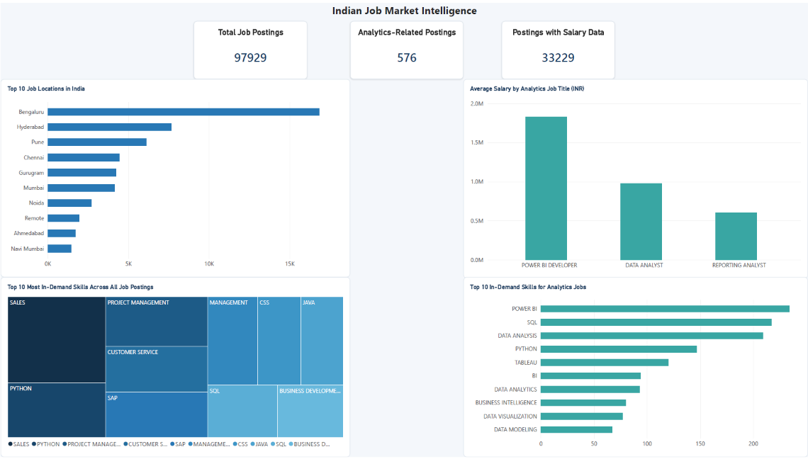
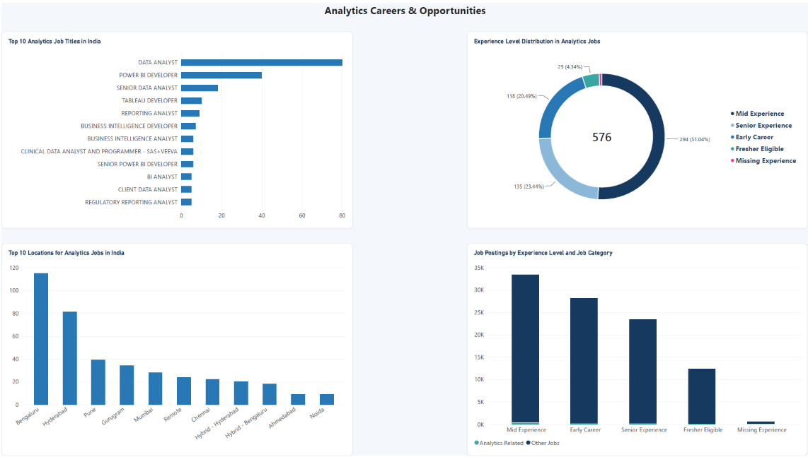
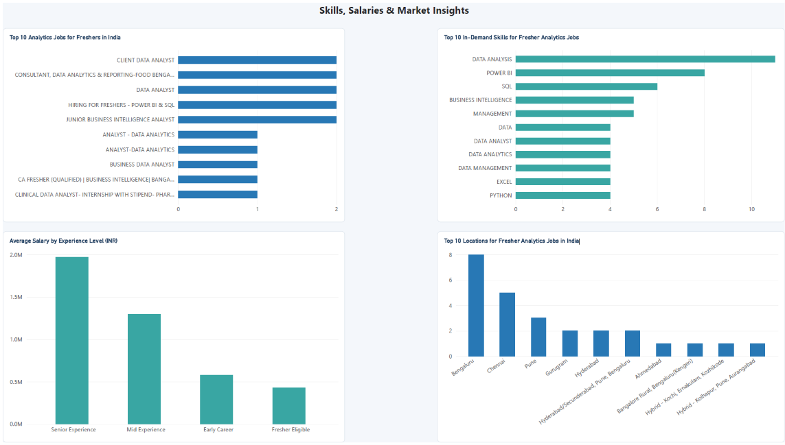

# Indian Job Market Intelligence: Skills, Salaries & Career Opportunities

## Project Overview

This project analyzes the Indian job market using Oracle SQL and Power BI to understand employment trends, in-demand skills, salary patterns, and career opportunities.

The main focus is to explore analytics-related job opportunities and identify the skills, experience levels, and locations relevant to aspiring data analysts.

## Tools & Technologies

- **Microsoft Excel** – Dataset inspection and preparation
- **Oracle SQL** – Data cleaning, querying, analysis, and views
- **Power BI** – Interactive dashboards and data visualization

## Dataset

The project uses the **Indian Job Market Dataset 2025**, containing more than 97,000 job postings across India.

The dataset includes information such as:
- Job titles and company names
- Locations
- Experience requirements
- Salary details
- Skills and tags
- Company ratings and review metrics

Both the original Excel dataset and the prepared CSV file used for SQL analysis are included in the `Dataset` folder.

## Dashboard Pages

### 1. Indian Job Market Intelligence

- Total job postings and analytics-related postings
- Top 10 job locations
- Average salary by analytics job title
- Most in-demand skills across all job postings
- Most in-demand skills for analytics jobs



### 2. Analytics Careers & Opportunities

- Top analytics job titles
- Experience-level distribution
- Top locations for analytics jobs
- Job postings by experience level and category



### 3. Skills, Salaries & Market Insights

- Top analytics jobs suitable for freshers
- Average salary by experience level
- Most in-demand skills for fresher-friendly analytics jobs
- Top locations for fresher-friendly analytics jobs



## Key Project Insights

- The dataset contains **97,929 job postings**.
- **576 postings** were classified as analytics-related.
- Power BI, SQL, Data Analysis, and Python appeared frequently among analytics-related job skills.
- Bengaluru and Hyderabad had the highest number of analytics-related postings in this dataset.
- Salary information was not available for every job posting, so salary analysis uses only records with usable salary data.

## Dataset Credits & Licence

**Original Dataset:** Indian Job Market Dataset 2025  
**Source:** [Kaggle – Indian Job Market Dataset 2025](https://www.kaggle.com/datasets/shivamshrivastava21/indian-job-market-dataset-2025-2026)  
**Licence:** [Creative Commons Attribution-NonCommercial-ShareAlike 4.0 International (CC BY-NC-SA 4.0)](https://creativecommons.org/licenses/by-nc-sa/4.0/)

The original dataset belongs to its respective creator. It is used in this project with attribution under the stated licence.

This project is intended for educational and non-commercial purposes. Any redistribution or adaptation of the dataset must comply with the original licence terms.

## Project Structure

```text
Indian-Job-Market-Intelligence/
│
├── Dataset/
│   ├── indian-job-market-dataset-2025.xlsx
│   └── job_market_raw_oracle.csv
│
├── PowerBI/
│   ├── Main.pbix
│   └── Main.pdf
│
├── screenshots/
│   ├── page-1-job-market.png
│   ├── page-2-analytics-careers.png
│   └── page-3-skills-salaries.png
│
└── README.md
```

## Purpose

The purpose of this project is to apply SQL and Power BI skills to a real-world dataset, develop analytical thinking, and present useful insights through interactive dashboards.

---

**Created as a Data Analytics Portfolio Project.**
